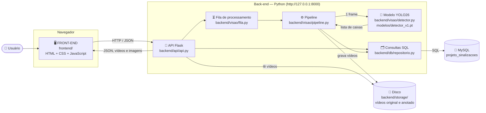
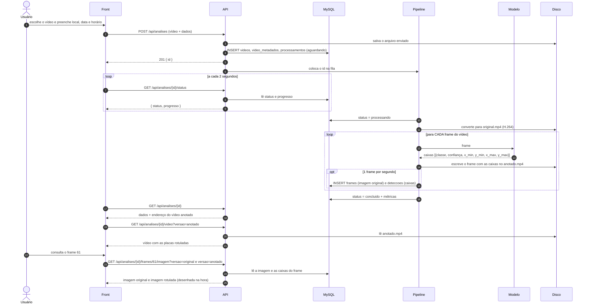
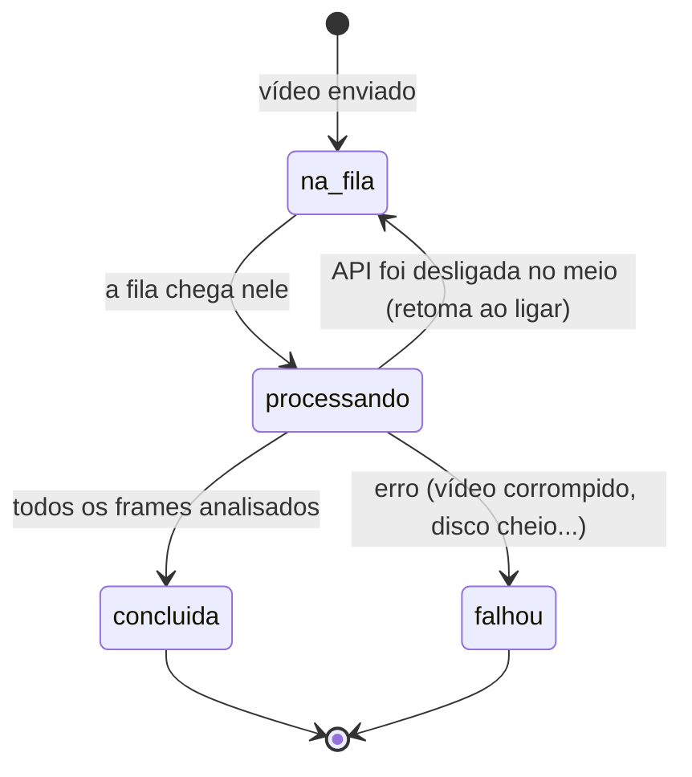
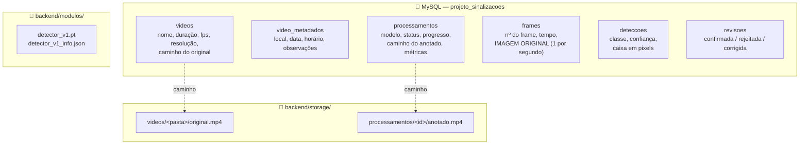
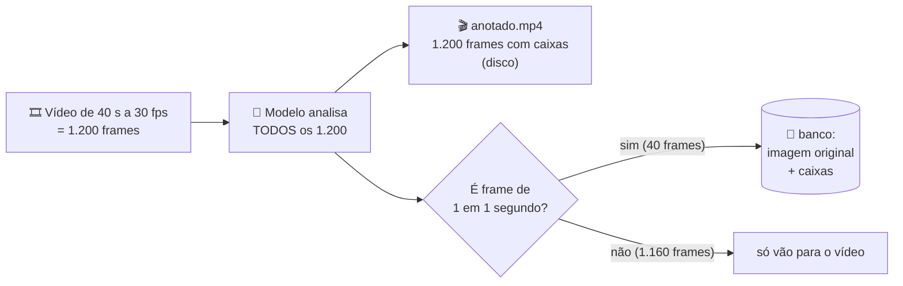
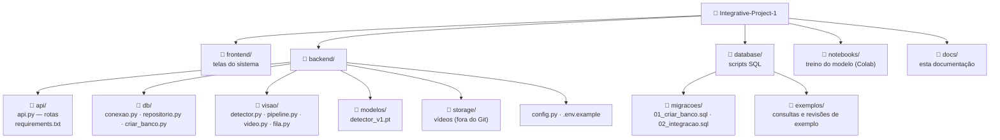

# 🗺️ Arquitetura visual do projeto

Este documento mostra, com desenhos, **como as três partes do projeto se encaixam**:
o **front-end** (as telas), o **back-end** (a API + o modelo de visão computacional) e o **banco de dados** (MySQL).

> Os diagramas são desenhados automaticamente pelo GitHub (Mermaid).
> Se você abrir este arquivo no VS Code e não aparecerem os desenhos, instale a extensão
> *Markdown Preview Mermaid Support* e use **Ctrl + Shift + V**.

---

## 1. Visão geral em uma frase

> O usuário envia um vídeo pelo **front**; a **API** guarda o vídeo, passa cada frame pelo **modelo**,
> grava os resultados no **banco** e devolve ao front o **vídeo com as placas rotuladas** e os **frames para consulta**.

---

## 2. As peças e quem conversa com quem

**Três regras que explicam quase tudo:**

| Regra | Por quê |
|---|---|
| O **front nunca fala com o banco** | Só a API conhece a senha do banco. O front pede tudo à API |
| O **modelo não conhece o banco nem o front** | Ele só recebe uma imagem e devolve as caixas encontradas. Quem decide o que fazer com isso é o pipeline |
| A **API é o centro** | É a única peça ligada a todas as outras. Ela também entrega as páginas do front, por isso tudo funciona no mesmo endereço |

---

## 3. O caminho de um vídeo, do envio ao resultado

---

## 4. A vida de uma análise (status)

| No front | No banco (`processamentos.status`) | O que significa |
|---|---|---|
| Na fila | `aguardando` | Esperando outro vídeo terminar (os vídeos são processados um de cada vez) |
| Processando | `processando` | O modelo está analisando; `progresso` vai de 0 a 1 |
| Concluída | `concluido` | Vídeo anotado e frames prontos para consulta |
| Falhou | `erro` | A mensagem fica em `processamentos.mensagem_erro` |

---

## 5. Onde cada informação fica guardada

| Informação | Onde fica | Observação |
|---|---|---|
| Vídeo original e vídeo anotado | Disco (`backend/storage/`) | O banco guarda só o **caminho** |
| Imagem original dos frames de consulta | Banco (`frames.imagem`) | Só 1 frame por segundo de vídeo |
| Imagem **rotulada** dos frames | **Não é guardada** | A API desenha as caixas na hora, usando a tabela `deteccoes` |
| Caixas, classe, confiança | Banco (`deteccoes`) | Em pixels do frame original |
| Revisões humanas | Banco (`revisoes`) | A resposta da IA nunca é alterada |
| Modelo treinado | Disco (`backend/modelos/`) | Vai para o GitHub (≈5 MB) |

---

## 6. Por que só 1 frame por segundo vai para o banco?

Guardar os 1.200 frames ocuparia ≈250 MB por vídeo no banco e tornaria a revisão impraticável.
Com 1 por segundo, são ≈40 imagens (alguns MB), suficientes para **consultar** e **revisar**.
O intervalo pode ser mudado em `INTERVALO_EXTRACAO_S` no `backend/.env`.

> As métricas mostradas (ex.: "Detecções: 41") contam **detecções nos frames guardados**,
> e não placas diferentes: a mesma placa aparece em vários frames seguidos.

---

## 7. Organização das pastas

---

## 8. Quem cuida de quê

| Parte | Equipe | Arquivos principais | Documento |
|---|---|---|---|
| Telas | Front-end | `frontend/` | [05_FRONTEND.md](05_FRONTEND.md) |
| Rotas, regras e integração | Back-end | `backend/api/`, `backend/db/` | [04_API.md](04_API.md) |
| Modelo e processamento do vídeo | Visão computacional | `backend/visao/`, `backend/modelos/`, `notebooks/` | [04_API.md](04_API.md#7-o-modelo-e-o-pipeline) |
| Estrutura dos dados | Banco de dados | `database/` | [03_BANCO_DE_DADOS.md](03_BANCO_DE_DADOS.md) |
| Rodar tudo na sua máquina | Todos | — | [02_MANUAL_DE_EXECUCAO.md](02_MANUAL_DE_EXECUCAO.md) |

**O "contrato" entre as equipes** são as rotas da API e os formatos JSON descritos em [04_API.md](04_API.md).
Se uma equipe muda algo nesse contrato, avisa as outras e atualiza a documentação no mesmo Pull Request.
