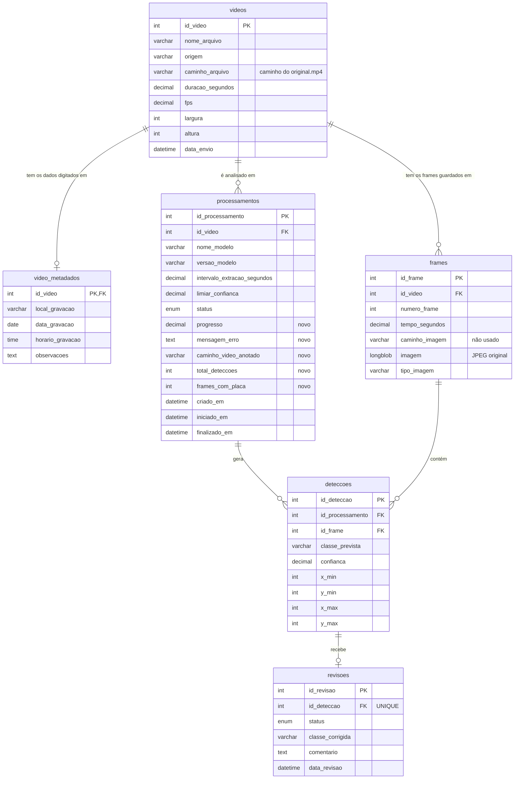
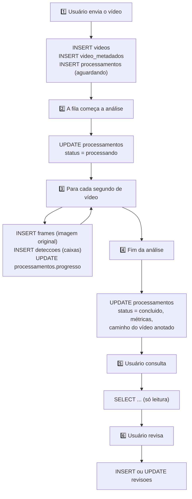
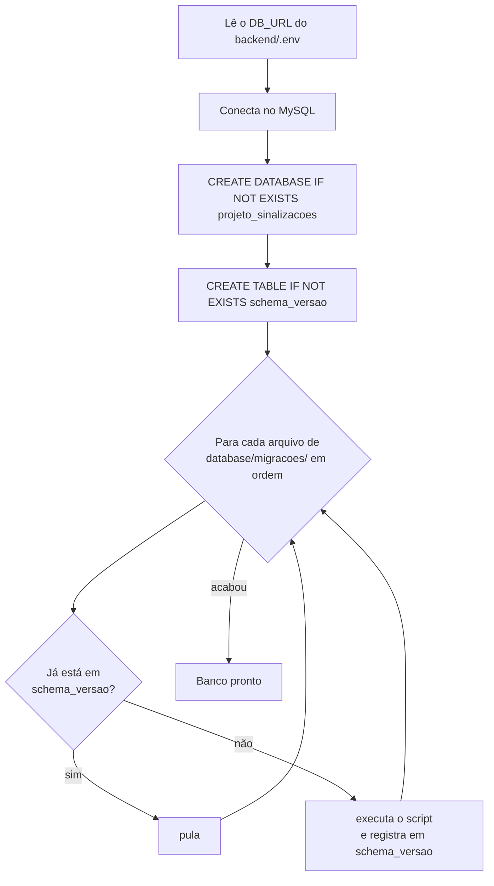
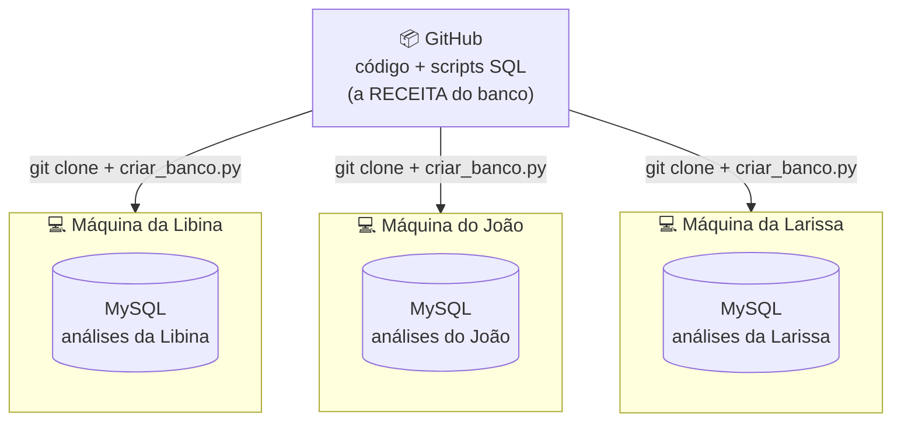

# 🐬 Banco de dados — `projeto_sinalizacoes` (MySQL 8)

Este documento explica **como o banco está organizado**, **o que cada tabela guarda** e,
principalmente, **o que acontece no banco em cada momento do uso do sistema**.

A estrutura foi criada pela **equipe de banco de dados** (`database/migracoes/01_criar_banco.sql`)
e recebeu alguns acréscimos para a integração com a API e o modelo (`02_integracao.sql`).

---

## Sumário

1. [Ideias principais](#1-ideias-principais)
2. [Diagrama das tabelas](#2-diagrama-das-tabelas)
3. [As tabelas, uma a uma](#3-as-tabelas-uma-a-uma)
4. [O banco durante o uso do sistema](#4-o-banco-durante-o-uso-do-sistema)
5. [O que fica no banco e o que fica no disco](#5-o-que-fica-no-banco-e-o-que-fica-no-disco)
6. [Como o banco é criado e atualizado (migrações)](#6-como-o-banco-é-criado-e-atualizado-migrações)
7. [Cada pessoa tem o seu banco](#7-cada-pessoa-tem-o-seu-banco)
8. [Consultas úteis para explorar os dados](#8-consultas-úteis-para-explorar-os-dados)
9. [Regras combinadas entre as equipes](#9-regras-combinadas-entre-as-equipes)
10. [Perguntas frequentes](#10-perguntas-frequentes)

---

## 1. Ideias principais

| Conceito | Explicação |
|---|---|
| **Vídeo** | O arquivo enviado pelo usuário. Fica na tabela `videos`, com os dados digitados na tela em `video_metadados` |
| **Processamento** (= "análise" no front) | Cada vez que a IA analisa um vídeo. Guarda o modelo usado, o status e os resultados gerais |
| **Frame** | Uma "foto" tirada do vídeo. Só **1 por segundo** é guardado, com a imagem **original** |
| **Detecção** | Algo que a IA encontrou num frame: a classe (`placa`), a confiança e a caixa em pixels |
| **Revisão** | A opinião de uma pessoa sobre uma detecção: confirmada, rejeitada ou corrigida |

> **Uma análise do front = uma linha de `processamentos`.** O número que aparece no front
> (ex.: "Análise #7") é o `id_processamento`.

---

## 2. Diagrama das tabelas



**Como ler as ligações:**

| Ligação | Significa |
|---|---|
| `videos` → `video_metadados` (1 para 1) | Cada vídeo tem uma linha de metadados (local, data, horário) |
| `videos` → `frames` (1 para muitos) | Um vídeo tem vários frames guardados |
| `videos` → `processamentos` (1 para muitos) | Um vídeo pode ser analisado mais de uma vez (ex.: com um modelo novo). Hoje cada envio gera 1 processamento |
| `processamentos` → `deteccoes` (1 para muitos) | Uma análise gera várias detecções |
| `frames` → `deteccoes` (1 para muitos) | Um frame pode ter várias placas |
| `deteccoes` → `revisoes` (1 para 0 ou 1) | Cada detecção tem **no máximo uma** revisão (`UNIQUE`). Sem revisão = **pendente** |

Todas as ligações usam `ON DELETE CASCADE`: apagar um vídeo apaga seus metadados, frames,
processamentos, detecções e revisões.

---

## 3. As tabelas, uma a uma

### `videos` — o arquivo enviado

| Coluna | Tipo | O que guarda | Exemplo |
|---|---|---|---|
| `id_video` | INT (PK) | Número único do vídeo | `12` |
| `nome_arquivo` | VARCHAR(255) | Nome original do arquivo | `av_higienopolis.mp4` |
| `origem` | VARCHAR(150) | De onde veio | `upload` |
| `caminho_arquivo` | VARCHAR(500) | Onde o vídeo está, **relativo a `backend/storage/`** | `videos/9f2c…/original.mp4` |
| `duracao_segundos` | DECIMAL(10,3) | Duração | `32.500` |
| `fps` | DECIMAL(8,3) | Frames por segundo | `30.000` |
| `largura`, `altura` | INT | Resolução em pixels | `1920`, `1080` |
| `data_envio` | DATETIME | Quando foi enviado (automático) | `2026-11-09 10:12:03` |

### `video_metadados` — o que o usuário digitou

| Coluna | Tipo | O que guarda | Campo no front |
|---|---|---|---|
| `id_video` | INT (PK e FK) | Mesmo número do vídeo | — |
| `local_gravacao` | VARCHAR(150) | Endereço genérico (obrigatório) | **Local** |
| `data_gravacao` | DATE | Dia da gravação | **Data** |
| `horario_gravacao` | TIME | Hora da gravação | **Horário** |
| `observacoes` | TEXT | Texto livre | **Observações** |

### `processamentos` — cada análise feita pela IA

| Coluna | Tipo | O que guarda |
|---|---|---|
| `id_processamento` | INT (PK) | Número da análise (é o que aparece no front) |
| `id_video` | INT (FK) | Vídeo analisado |
| `nome_modelo`, `versao_modelo` | VARCHAR | Modelo usado. Ex.: `yolo26n` / `detector_v1` |
| `intervalo_extracao_segundos` | DECIMAL | De quantos em quantos segundos um frame é guardado (padrão `1`) |
| `limiar_confianca` | DECIMAL | Confiança mínima para aceitar uma detecção (padrão do modelo: `0.25`) |
| `status` | ENUM | `aguardando`, `processando`, `concluido` ou `erro` |
| `progresso` *(novo)* | DECIMAL(4,3) | Andamento de 0 a 1 (ex.: `0.450` = 45%) |
| `mensagem_erro` *(novo)* | TEXT | Motivo da falha, quando `status = 'erro'` |
| `caminho_video_anotado` *(novo)* | VARCHAR(500) | Vídeo com as caixas, relativo a `backend/storage/` |
| `total_deteccoes` *(novo)* | INT | Quantas detecções nos frames guardados |
| `frames_com_placa` *(novo)* | INT | Quantos frames guardados têm pelo menos 1 placa |
| `criado_em`, `iniciado_em`, `finalizado_em` | DATETIME | Quando foi enviado, começou e terminou |

### `frames` — as "fotos" guardadas para consulta

| Coluna | Tipo | O que guarda |
|---|---|---|
| `id_frame` | INT (PK) | Número único do frame no banco |
| `id_video` | INT (FK) | Vídeo de onde veio |
| `numero_frame` | INT | Posição no vídeo, começando em **1** (o frame 31 é o primeiro do segundo 1 num vídeo a 30 fps) |
| `tempo_segundos` | DECIMAL | Momento no vídeo (ex.: `1.000`) |
| `caminho_imagem` | VARCHAR | Previsto pela equipe; **não é usado** (a imagem fica no BLOB) |
| `imagem` | LONGBLOB | **A imagem original em JPEG** (sem caixas) |
| `tipo_imagem` | VARCHAR | `image/jpeg` |

Regra nova: `UNIQUE (id_video, numero_frame)` — o mesmo frame não pode aparecer duas vezes.

### `deteccoes` — o que a IA encontrou

| Coluna | Tipo | O que guarda |
|---|---|---|
| `id_deteccao` | INT (PK) | Número da detecção |
| `id_processamento` | INT (FK) | Em qual análise |
| `id_frame` | INT (FK) | Em qual frame |
| `classe_prevista` | VARCHAR | O que a IA acha que é. Hoje sempre `placa` |
| `confianca` | DECIMAL(5,4) | Certeza de 0 a 1 (`0.9300` = 93%) |
| `x_min`, `y_min` | INT | Canto **superior esquerdo** da caixa, em pixels |
| `x_max`, `y_max` | INT | Canto **inferior direito** da caixa, em pixels |

```
(0,0) ──────────────────────────► x
  │      (x_min, y_min)
  │          ┌──────────┐
  │          │  PLACA   │
  │          └──────────┘
  │                 (x_max, y_max)
  ▼ y
```

### `revisoes` — a opinião humana

| Coluna | Tipo | O que guarda |
|---|---|---|
| `id_revisao` | INT (PK) | Número da revisão |
| `id_deteccao` | INT (FK, **UNIQUE**) | Detecção revisada (no máximo 1 revisão cada) |
| `status` | ENUM | `confirmada`, `rejeitada` ou `corrigida` (`pendente` existe no ENUM mas não é gravado pela API) |
| `classe_corrigida` | VARCHAR | Classe certa, quando `corrigida` (ex.: `Semáforo`) |
| `comentario` | TEXT | Justificativa/observação |
| `data_revisao` | DATETIME | Quando foi revisada |

> **Princípio da equipe de banco:** a resposta da IA (`deteccoes`) **nunca é alterada**.
> A correção fica separada em `revisoes`, então sempre dá para comparar "o que a IA disse" com "o que a pessoa disse".

### `schema_versao` — controle interno

Criada automaticamente pelo `criar_banco.py`. Registra quais scripts de `database/migracoes/` já foram aplicados.

| Coluna | Exemplo |
|---|---|
| `arquivo` | `02_integracao.sql` |
| `aplicado_em` | `2026-11-09 01:52:39` |

---

## 4. O banco durante o uso do sistema

Abaixo, **cada ação do usuário** e **exatamente o que acontece no banco**.
(O código dessas operações está em `backend/db/repositorio.py`.)



### Passo 1 — O usuário envia o vídeo

A API salva o arquivo no disco, confere duração e formato e grava **em uma única transação**
(ou grava tudo, ou nada):

```sql
INSERT INTO videos (nome_arquivo, origem, caminho_arquivo, duracao_segundos, fps, largura, altura)
VALUES ('av_higienopolis.mp4', 'upload', 'videos/9f2c.../envio.mov', 32.5, 30, 1920, 1080);

INSERT INTO video_metadados (id_video, local_gravacao, data_gravacao, horario_gravacao, observacoes)
VALUES (12, 'Av. Higienópolis, Centro', '2026-11-08', '14:30', NULL);

INSERT INTO processamentos (id_video, nome_modelo, versao_modelo, intervalo_extracao_segundos,
                            limiar_confianca, status)
VALUES (12, 'yolo26n', 'detector_v1', 1, 0.25, 'aguardando');
```

O front recebe o `id_processamento` e começa a perguntar o status a cada 2 segundos.

### Passo 2 — A análise começa

```sql
-- limpa restos de uma tentativa anterior interrompida (normalmente não há nada)
DELETE FROM deteccoes WHERE id_processamento = 7;
DELETE FROM frames    WHERE id_video = 12;

UPDATE processamentos SET status = 'processando', progresso = 0, iniciado_em = NOW()
WHERE id_processamento = 7;
```

O vídeo é convertido para MP4 H.264 e a API atualiza o caminho e as medidas reais:

```sql
UPDATE videos SET caminho_arquivo = 'videos/9f2c.../original.mp4', fps = 30, ... WHERE id_video = 12;
```

### Passo 3 — Durante a análise

Todos os frames passam pelo modelo, mas **só os frames de 1 em 1 segundo** (1, 31, 61, 91… a 30 fps)
vão para o banco, em lotes de 10:

```sql
INSERT INTO frames (id_video, numero_frame, tempo_segundos, imagem, tipo_imagem)
VALUES (12, 61, 2.000, <bytes do JPEG original>, 'image/jpeg');

INSERT INTO deteccoes (id_processamento, id_frame, classe_prevista, confianca, x_min, y_min, x_max, y_max)
VALUES (7, 503, 'placa', 0.9312, 120, 55, 190, 160);
```

E, de tempos em tempos, o progresso:

```sql
UPDATE processamentos SET progresso = 0.450 WHERE id_processamento = 7;
```

### Passo 4 — Fim da análise

```sql
UPDATE processamentos
SET status = 'concluido', progresso = 1, caminho_video_anotado = 'processamentos/7/anotado.mp4',
    total_deteccoes = 41, frames_com_placa = 19, finalizado_em = NOW()
WHERE id_processamento = 7;
```

Se algo der errado:

```sql
UPDATE processamentos SET status = 'erro', mensagem_erro = 'Falha ao converter o vídeo: ...',
       finalizado_em = NOW()
WHERE id_processamento = 7;
```

> **E se a API for desligada no meio?** Ao ligar de novo, ela muda os processamentos `processando`
> para `aguardando` e os coloca na fila outra vez. O passo 2 limpa o que tinha sido gravado pela metade.

### Passo 5 — O usuário consulta (só leitura)

| O que o usuário vê | Consulta (resumida) |
|---|---|
| Lista de análises | `processamentos JOIN videos LEFT JOIN video_metadados` |
| Detecções da análise | `deteccoes JOIN frames JOIN videos LEFT JOIN revisoes` (sem revisão = `pendente`) |
| Lista de frames guardados | `frames` + `COUNT(deteccoes)` por frame (sem carregar as imagens) |
| Imagem **original** de um frame | `SELECT imagem FROM frames WHERE ...` |
| Imagem **rotulada** de um frame | A mesma imagem + as caixas de `deteccoes`, desenhadas pela API na hora (nada é gravado) |
| Visão geral e relatórios | Somas e contagens por período, classe e situação da revisão |

### Passo 6 — O usuário revisa

A API verifica se a detecção já tem revisão. Se não tem, cria; se tem, atualiza:

```sql
-- primeira revisão
INSERT INTO revisoes (id_deteccao, status, classe_corrigida, comentario, data_revisao)
VALUES (315, 'corrigida', 'Semáforo', 'era um semáforo', NOW());

-- mudou de ideia depois
UPDATE revisoes SET status = 'confirmada', classe_corrigida = NULL, comentario = NULL, data_revisao = NOW()
WHERE id_deteccao = 315;
```

---

## 5. O que fica no banco e o que fica no disco

| Dado | Onde | Tamanho típico (vídeo de 40 s em 1080p) |
|---|---|---|
| Metadados, status, métricas | Banco | bytes |
| Imagem original de **1 frame por segundo** | Banco (`frames.imagem`) | ≈40 imagens, ≈8 MB |
| Caixas das detecções | Banco (`deteccoes`) | KB |
| Vídeo original (H.264) | Disco: `backend/storage/videos/` | dezenas de MB |
| Vídeo anotado | Disco: `backend/storage/processamentos/` | dezenas de MB |
| Imagem rotulada dos frames | **Em lugar nenhum**: desenhada sob demanda | — |

**Por que os vídeos não ficam no banco?** São arquivos grandes; bancos relacionais ficam lentos e
pesados com eles. O padrão é guardar o arquivo em disco e o **caminho** no banco.

**Por que as imagens dos frames ficam no banco?** Foi a escolha da equipe de banco (coluna `LONGBLOB`).
Como são poucas por vídeo, funciona bem e o banco fica completo para consulta.

> ⚠️ Como os vídeos ficam no disco, apagar a pasta `backend/storage/` deixa as análises sem vídeo
> (o banco continua apontando para arquivos que não existem). Para "zerar" tudo, apague também o banco
> (`DROP DATABASE projeto_sinalizacoes;`) e rode `python backend/db/criar_banco.py` de novo.

---

## 6. Como o banco é criado e atualizado (migrações)

### A pasta `database/`

```
database/
├── migracoes/                  ← mudam a ESTRUTURA. Aplicadas em ordem, uma única vez
│   ├── 01_criar_banco.sql      (equipe de banco: as 6 tabelas)
│   └── 02_integracao.sql       (integração: colunas novas e UNIQUE)
├── exemplos/                   ← só para estudo/teste, nunca rodam automaticamente
│   ├── 03_consultas.sql
│   └── 04_revisar_deteccoes.sql
└── README.md
```

### O comando `criar_banco.py`

```bash
python backend/db/criar_banco.py
```



| Situação | O que acontece |
|---|---|
| Banco não existe | Cria tudo |
| Banco já existe (criado pelo Workbench com o `01`) | Usa o mesmo banco; o `01` não muda nada (`IF NOT EXISTS`) e o `02` acrescenta as colunas. **Dados mantidos** |
| Rodar de novo | Nada acontece (tudo já registrado) |
| Script novo adicionado por alguém | Só ele é aplicado |

**O comando nunca apaga tabelas ou dados.**

### Já criei o banco pelo Workbench

Se você rodou o `02_integracao.sql` **à mão** antes, o comando tentaria aplicá-lo de novo e daria
`Duplicate column name`. Registre os scripts como aplicados (no Workbench) e rode o comando de novo:

```sql
USE projeto_sinalizacoes;
CREATE TABLE IF NOT EXISTS schema_versao (arquivo VARCHAR(255) PRIMARY KEY, aplicado_em DATETIME DEFAULT CURRENT_TIMESTAMP);
INSERT IGNORE INTO schema_versao (arquivo) VALUES ('01_criar_banco.sql'), ('02_integracao.sql');
```

### Como mudar a estrutura no futuro

1. **Nunca edite** um script que já foi aplicado (os colegas já rodaram a versão antiga).
2. Crie um **arquivo novo numerado** em `migracoes/`, por exemplo `03_tabela_ocorrencias.sql`:
   ```sql
   USE projeto_sinalizacoes;
   CREATE TABLE ocorrencias ( ... );
   ```
3. Avise o back-end se a mudança afeta colunas que a API usa.
4. Cada pessoa roda `python backend/db/criar_banco.py` depois do `git pull`.

---

## 7. Cada pessoa tem o seu banco



- O GitHub guarda a **receita** do banco (os scripts), **não os dados**.
- Cada pessoa que roda o `criar_banco.py` ganha um banco com **a mesma estrutura, vazio**.
- As análises de cada um ficam só na máquina de cada um (assim como os vídeos em `backend/storage/`).
- A senha também é de cada um (`backend/.env`, que não vai para o GitHub).

Isso é o normal durante o desenvolvimento. **Para apresentar**, use uma máquina só com alguns vídeos
já processados. Se o grupo precisar ver os mesmos dados ao mesmo tempo, será preciso um servidor único
(rodando API + MySQL + a pasta `storage`) acessado por todos pelo navegador.

---

## 8. Consultas úteis para explorar os dados

Rode no MySQL Workbench (*Local instance*, usuário `root`). Troque o `7` pelo número da sua análise.

```sql
USE projeto_sinalizacoes;

-- Análises com local e status
SELECT p.id_processamento, v.nome_arquivo, m.local_gravacao, p.status, p.progresso,
       p.total_deteccoes, p.frames_com_placa, p.criado_em
FROM processamentos p
JOIN videos v               ON v.id_video = p.id_video
LEFT JOIN video_metadados m ON m.id_video = p.id_video
ORDER BY p.criado_em DESC;

-- Frames guardados de uma análise e quantas placas cada um tem (sem carregar as imagens)
SELECT f.numero_frame, f.tempo_segundos, OCTET_LENGTH(f.imagem) AS bytes, COUNT(d.id_deteccao) AS placas
FROM processamentos p
JOIN frames f         ON f.id_video = p.id_video
LEFT JOIN deteccoes d ON d.id_frame = f.id_frame AND d.id_processamento = p.id_processamento
WHERE p.id_processamento = 7
GROUP BY f.id_frame, f.numero_frame, f.tempo_segundos, bytes
ORDER BY f.numero_frame;

-- Detecções com a revisão (sem linha em revisoes = pendente)
SELECT d.id_deteccao, f.numero_frame, f.tempo_segundos, d.classe_prevista, d.confianca,
       d.x_min, d.y_min, d.x_max, d.y_max,
       COALESCE(r.status, 'pendente') AS revisao, r.classe_corrigida, r.comentario
FROM deteccoes d
JOIN frames f        ON f.id_frame = d.id_frame
LEFT JOIN revisoes r ON r.id_deteccao = d.id_deteccao
WHERE d.id_processamento = 7
ORDER BY f.numero_frame;

-- Quanto espaço as imagens ocupam por vídeo
SELECT id_video, COUNT(*) AS frames, ROUND(SUM(OCTET_LENGTH(imagem)) / 1024 / 1024, 1) AS mb
FROM frames GROUP BY id_video;
```

Mais exemplos em `database/exemplos/`.

---

## 9. Regras combinadas entre as equipes

| Regra | Motivo |
|---|---|
| Não renomear tabelas ou colunas sem avisar o back-end | As consultas da API (`backend/db/repositorio.py`) usam esses nomes |
| Não mudar o nome do banco (`projeto_sinalizacoes`) | Os scripts e o `.env` usam esse nome |
| Mudanças de estrutura = novo arquivo numerado em `migracoes/` | Assim todos recebem a mudança sem perder dados |
| Dados de exemplo vão em `exemplos/`, nunca em `migracoes/` | Para não serem inseridos automaticamente no banco de todo mundo |
| Não criar linhas `pendente` em `revisoes` antecipadamente | "Sem revisão" já significa pendente |
| Valores esperados pela API | `processamentos.status`: `aguardando`, `processando`, `concluido`, `erro` · `revisoes.status`: `confirmada`, `rejeitada`, `corrigida` · classe do modelo: `placa` |

**Tradução feita pela API** (o banco e o front usam nomes diferentes para os status; ninguém precisa mudar):

| Banco | Front |
|---|---|
| `aguardando` | `na_fila` |
| `processando` | `processando` |
| `concluido` | `concluida` |
| `erro` | `falhou` |
| sem linha em `revisoes` | `pendente` |

---

## 10. Perguntas frequentes

**Por que o número da análise não é igual ao número do vídeo?**
São tabelas diferentes (`processamentos` e `videos`). Hoje andam juntos, mas um vídeo pode ter mais de uma análise no futuro.

**A mesma placa aparece em várias detecções. É erro?**
Não. A placa aparece em vários frames seguidos (1 por segundo guardado), e cada frame gera a sua detecção.
O sistema conta **detecções**, não placas diferentes. Contar placas únicas exigiria rastreamento (uma coluna `track_id`).

**Posso apagar uma análise?**
Ainda não há botão para isso. Pelo Workbench, `DELETE FROM videos WHERE id_video = 12;` apaga tudo
ligado ao vídeo (cascade), mas os arquivos em `backend/storage/` precisam ser apagados à mão.

**Por que `frames.caminho_imagem` está sempre vazio?**
A equipe deixou as duas opções (caminho ou bytes). A integração usa os bytes (`imagem`), então o caminho não é preenchido.

**Onde vejo qual modelo gerou uma análise?**
Em `processamentos.nome_modelo` e `versao_modelo`. Isso permite comparar um modelo novo com o atual.
