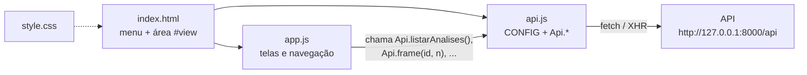
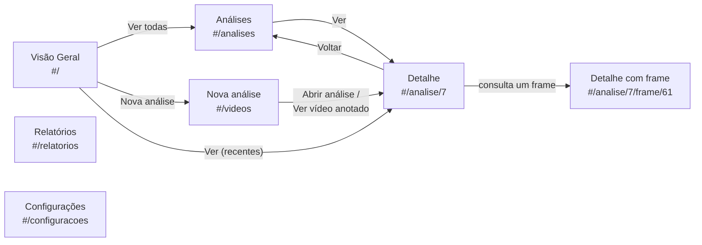
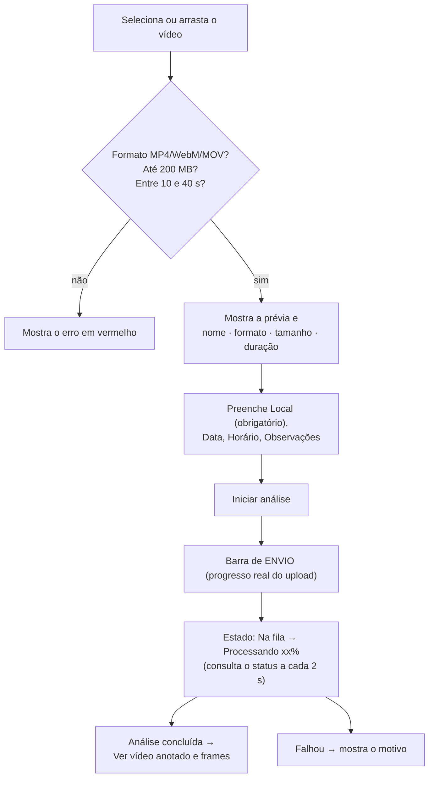
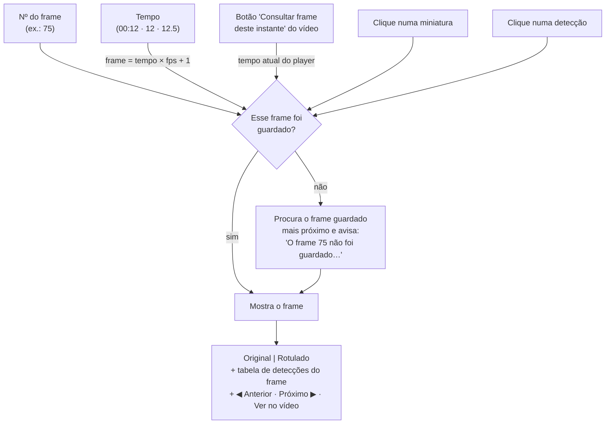
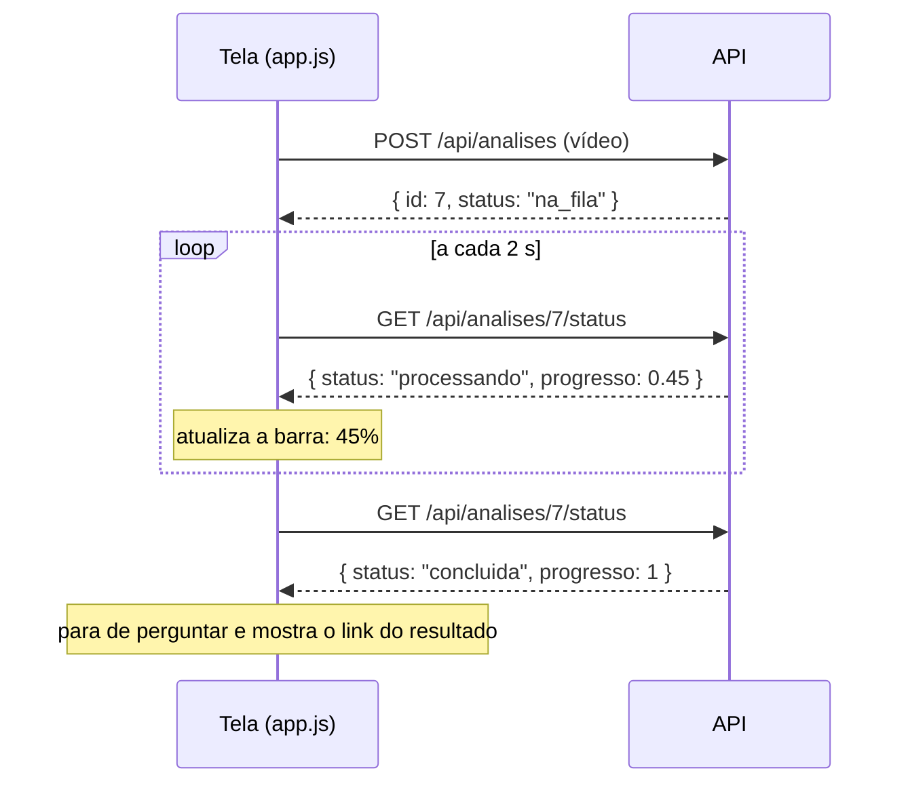

# 🖥️ Front-end — as telas do sistema

O front-end é a parte que o usuário vê no navegador. Foi desenvolvido originalmente pela equipe de front
([luizfelipeyg-crypto/frontend_monitoramento_vias](https://github.com/luizfelipeyg-crypto/frontend_monitoramento_vias))
e adaptado para a versão integrada (v0.2.0), que se comunica com a API, o banco e o modelo.

É feito com **HTML, CSS e JavaScript puros**, sem frameworks (sem React, sem Node.js, sem etapa de build):
os arquivos são abertos diretamente pelo navegador.

---

## Sumário

1. [Os arquivos](#1-os-arquivos)
2. [Como o front é aberto](#2-como-o-front-é-aberto)
3. [Como o front conversa com a API](#3-como-o-front-conversa-com-a-api)
4. [Navegação entre as telas](#4-navegação-entre-as-telas)
5. [As telas, uma a uma](#5-as-telas-uma-a-uma)
6. [A consulta de frames por dentro](#6-a-consulta-de-frames-por-dentro)
7. [Acompanhamento do processamento](#7-acompanhamento-do-processamento)
8. [Peças reutilizáveis do app.js](#8-peças-reutilizáveis-do-appjs)
9. [Estilos (style.css)](#9-estilos-stylecss)
10. [Como fazer mudanças](#10-como-fazer-mudanças)
11. [O que mudou em relação à versão original](#11-o-que-mudou-em-relação-à-versão-original)

---

## 1. Os arquivos

```
frontend/
├── index.html   → o "esqueleto": menu lateral, área principal, janela modal e avisos
├── style.css    → cores, tamanhos, layout e versão para celular
├── api.js       → a ÚNICA parte que fala com o back-end (todas as chamadas à API)
├── app.js       → as telas, a navegação e as interações
└── README.md
```

A ordem de carregamento no `index.html` importa: primeiro `api.js` (define `CONFIG` e `Api`), depois `app.js` (usa os dois).



---

## 2. Como o front é aberto

| Forma | Endereço | Quando usar |
|---|---|---|
| **Pela própria API** (padrão) | `http://127.0.0.1:8000` | Uso normal e apresentação. Só precisa da API ligada |
| **Pelo Live Server do VS Code** | `http://127.0.0.1:5500/frontend/index.html` | Desenvolvimento do front: a página recarrega sozinha ao salvar. A API precisa estar ligada também |

O `api.js` **descobre sozinho** onde está a API:

```js
// se a página veio da própria API → usa '/api' (mesmo endereço)
// se veio do Live Server (porta 5500 ou 5501) ou foi aberta como arquivo → usa 'http://127.0.0.1:8000/api'
// se window.API_URL foi definido antes do api.js → usa esse valor
```

Para usar uma API em outro endereço (ex.: outro computador da rede), adicione no `index.html`,
**antes** da linha do `api.js`:

```html
<script>window.API_URL = 'http://192.168.0.10:8000/api';</script>
```

---

## 3. Como o front conversa com a API

Todas as chamadas ficam em `frontend/api.js`, no objeto `Api`. As telas nunca usam `fetch` diretamente:
assim, se uma rota mudar, só o `api.js` precisa ser ajustado.

| Função em `api.js` | Rota chamada | Usada em |
|---|---|---|
| `Api.enviarVideo(arquivo, meta, aoProgredir)` | `POST /api/analises` | Nova análise (com barra de envio real) |
| `Api.listarAnalises()` | `GET /api/analises` | Análises |
| `Api.obterAnalise(id)` | `GET /api/analises/<id>` | Detalhe |
| `Api.statusProcessamento(id)` | `GET /api/analises/<id>/status` | Nova análise e Detalhe (a cada 2 s) |
| `Api.deteccoes(id)` | `GET /api/analises/<id>/deteccoes` | Detalhe |
| `Api.revisar(id, detId, acao, corpo)` | `POST /api/analises/<id>/deteccoes/<detId>/<acao>` | Detalhe (Confirmar/Rejeitar/Corrigir) |
| `Api.frames(id)` | `GET /api/analises/<id>/frames` | Consulta de frames (miniaturas) |
| `Api.frame(id, n)` | `GET /api/analises/<id>/frames/<n>` | Consulta de frames |
| `Api.imagemFrame(id, n, versao, largura)` | monta a URL de `/frames/<n>/imagem` | Imagens original/rotulada e miniaturas |
| `Api.video(id, versao, download)` | monta a URL de `/video` | Botões de download |
| `Api.url(caminho)` | — | Transforma `/api/...` em endereço completo |
| `Api.dashboard(dias)` | `GET /api/dashboard` | Visão Geral |
| `Api.relatorio(filtros)` | `GET /api/relatorios` | Relatórios |
| `Api.saude()` | `GET /api/saude` | Configurações |

**Tratamento de erros:** se a API responder com erro, o `api.js` lê a mensagem do campo `error`
(ex.: *"Informe o local da gravação."*) e a tela a mostra para o usuário. Uma resposta com formato
inesperado vira erro ("Resposta inválida da API") — nunca é mostrada como se fossem dados vazios.

Formatos completos das respostas: [04_API.md](04_API.md#6-formatos-dos-objetos-json).

---

## 4. Navegação entre as telas

O front é uma **página única**: o `index.html` nunca é recarregado. Trocar de tela muda só o que vem
depois do `#` no endereço, e o `app.js` desenha a tela correspondente dentro de `<main id="view">`.

| Endereço | Tela | Função no `app.js` |
|---|---|---|
| `#/` | Visão Geral | `pgGeral()` |
| `#/analises` | Lista de análises | `pgAnalises()` |
| `#/videos` | Nova análise (envio de vídeo) | `pgVideos()` |
| `#/analise/7` | Detalhe da análise 7 | `pgDetalhe('7')` |
| `#/analise/7/frame/61` | Detalhe da análise 7, já com o frame 61 aberto | `pgDetalhe('7', 61)` |
| `#/relatorios` | Relatórios | `pgRelatorios()` |
| `#/configuracoes` | Configurações | `pgConfig()` |
| qualquer outro | "Página não encontrada" | `naoEncontrada()` |



Quem decide qual tela desenhar é a função `rota()`, chamada sempre que o endereço muda (`hashchange`).
Antes de trocar de tela, ela executa a **limpeza** da tela anterior (para o acompanhamento de status,
libera a prévia do vídeo etc.).

---

## 5. As telas, uma a uma

### Visão Geral (`#/`)

| Elemento | De onde vem |
|---|---|
| 4 cartões: **Análises**, **Detecções**, **Frames com placa**, **Revisões pendentes** | `Api.dashboard(dias)` → `totais` |
| Seletor de período (7, 30 ou 90 dias) | guardado em `sessionStorage` (vale até fechar a aba) |
| Gráfico de barras "Detecções ao longo do tempo" | `serie` |
| "Distribuição por classe" | `distribuicao` |
| Tabela "Análises recentes" (5 últimas) | `recentes` |

### Análises (`#/analises`)

Tabela com ID, vídeo, local, data, duração, detecções e status (com a porcentagem quando está processando).
A busca, os filtros (status e local) e a paginação acontecem **no navegador**, sobre a lista recebida de `Api.listarAnalises()`.
O número de linhas por página vem das Configurações.

### Nova análise (`#/videos`)



- A duração é lida pelo próprio navegador antes do envio (evita mandar um vídeo que seria recusado).
- O envio usa `XMLHttpRequest` em vez de `fetch` porque só ele informa o progresso do upload.
- O usuário pode sair da tela: o processamento continua no servidor.

### Detalhe da análise (`#/analise/<id>`)

Se a análise ainda está **na fila ou processando**, a tela mostra os dados da gravação e uma barra de progresso,
e **se recarrega sozinha** quando termina. Se **falhou**, mostra o motivo.

Quando está **concluída**, a tela tem:

| Bloco | Conteúdo | Dados |
|---|---|---|
| Cabeçalho | Número da análise, nome do vídeo, modelo, status | `Api.obterAnalise(id)` |
| Dados da gravação | Local, data, horário, duração | idem |
| Resumo da detecção | Detecções, frames com placa, frames guardados, intervalo | idem |
| **Vídeo com as placas rotuladas** | Player do vídeo anotado (controles do navegador, tela cheia) | `videoUrl` → `/video?versao=anotado` |
| Botões do vídeo | **Baixar vídeo anotado**, **Baixar original**, **Consultar frame deste instante** | `Api.video(...)` |
| **Detecções** | Lista: tempo · nº do frame · classe · confiança · status da revisão. Filtros por classe e revisão | `Api.deteccoes(id)` |
| Ações de revisão | **Confirmar**, **Rejeitar**, **Corrigir** (abre uma janela para escolher a classe e justificar) | `Api.revisar(...)` |
| **Consulta de frames** | Busca + frame original e rotulado lado a lado + miniaturas | seção 6 |

Clicar numa detecção (fora dos botões) **leva o vídeo até aquele instante e abre o frame** na consulta.

### Relatórios (`#/relatorios`)

Filtros **De**, **Até** e **Local** → **Aplicar**. Mostra o total de análises, a porcentagem de detecções
confirmadas/rejeitadas/corrigidas, as detecções por classe e a situação das revisões.
**Exportar CSV** baixa os números numa planilha (separada por `;`, abre no Excel).

### Configurações (`#/configuracoes`)

| Item | Onde fica guardado |
|---|---|
| Registros por página (5, 10, 25, 50) | `localStorage` do navegador (só neste computador) |
| Classes disponíveis para correção e filtros (padrão: *Placa, Semáforo*) | `localStorage` |
| Estado da API (**Conectada/Desconectada**), modelo carregado, intervalo de frames | `Api.saude()` |

---

## 6. A consulta de frames por dentro

É a funcionalidade principal para **comparar o frame original com o rotulado**.

**De onde vêm as imagens:**

| Imagem | Rota | Como é produzida |
|---|---|---|
| Original | `/frames/<n>/imagem?versao=original` | Lida do banco (`frames.imagem`) |
| Rotulada | `/frames/<n>/imagem?versao=anotado` | A API pega a original e desenha as caixas na hora (tabela `deteccoes`) |
| Miniatura | `/frames/<n>/imagem?versao=anotado&largura=220` | Igual à rotulada, reduzida |

**Os jeitos de abrir um frame:**



**Detalhes de funcionamento** (função `pgDetalhe` → `consultar(n)` no `app.js`):

- A lista de frames guardados (`Api.frames(id)`) é carregada uma vez. Toda busca é feita sobre ela, sem ir à API.
- Só 1 frame por segundo é guardado; a 30 fps são os frames 1, 31, 61, 91… Por isso pedir o frame 75 mostra o 61 (mais próximo).
- **Só frames com placa** filtra a faixa de miniaturas e a navegação Anterior/Próximo.
- Ao abrir um frame, o endereço muda para `#/analise/<id>/frame/<n>` **sem recarregar a página**
  (`history.replaceState`). Copiar esse endereço abre a análise já no mesmo frame.
- **Ver no vídeo** pausa o player e o posiciona no instante do frame.
- As miniaturas usam `loading="lazy"`: só são baixadas quando aparecem na tela.
- Depois de revisar uma detecção, o frame aberto é recarregado para mostrar a revisão atualizada.

---

## 7. Acompanhamento do processamento

Depois do envio, o front pergunta à API **a cada 2 segundos** como está a análise, até ela terminar:



Isso é feito pela função `acompanhar(id, aoAtualizar, aoTerminar)`. Ela devolve uma função que **para**
as consultas, registrada com `aoSair(...)`: ao trocar de tela, as consultas param automaticamente.
Se a API não responder, a tela mostra "Sem resposta da API; tentando de novo…" e continua tentando.

---

## 8. Peças reutilizáveis do `app.js`

| Nome | O que faz |
|---|---|
| `$(seletor)` | Atalho para `document.querySelector` |
| `esc(texto)` | **Protege o HTML**: transforma `<`, `>`, `"` etc. em texto. Use sempre que mostrar dados vindos da API ou do usuário |
| `urlOk(url)` | Só aceita endereços `http://` ou `https://` (segurança para vídeos e imagens) |
| `mmss(segundos)` | `75` → `"01:15"` |
| `fdata(data)` | `"2026-11-08"` → `"08/11/2026"` |
| `pct(0.45)` | → `"45%"` |
| `tag(STATUS, 'concluida')` | Etiqueta colorida (verde "Concluída") |
| `STATUS`, `REV` | Nomes e cores dos status da análise e da revisão |
| `cab(título, subtítulo, botões)` | Cabeçalho padrão das telas |
| `tabela(lista)` | Tabela de análises (usada na Visão Geral e em Análises) |
| `vazio(texto)` | Mensagem cinza de "nada encontrado/carregando" |
| `aviso(erro)` | Faixa amarela de "Falha ao carregar" |
| `toast(msg, erro)` | Aviso rápido no canto da tela |
| `modal(html)` | Abre a janela de diálogo (usada em Corrigir) |
| `safe(promessa, padrão)` | Executa uma chamada à API e devolve `{d: dados, e: erro}` sem quebrar a tela |
| `acompanhar(...)` | Consulta o status a cada 2 s (seção 7) |
| `aoSair(fn)` | Registra algo a fazer quando o usuário trocar de tela |
| `rotaN` | Contador de trocas de tela: respostas que chegam atrasadas, de uma tela que já foi fechada, são ignoradas |
| `Cfg.get()` / `Cfg.set()` | Lê e salva as preferências (localStorage) |

---

## 9. Estilos (`style.css`)

- **Cores** definidas uma vez no início (`:root`): `--navy` (menu), `--blue`, `--green`, `--red`, `--yel`...
- **Componentes:** `.card` (caixas brancas), `.btn` / `.btn.pri` (botões), `.tag` (etiquetas), `.kpi` (cartões de número),
  `.grid.g2` / `.g4` (colunas), `.flt` (barra de filtros), `.di` (item da lista de detecções).
- **Consulta de frames:** `.cmp` (original e rotulado lado a lado), `.fbar` (barra Anterior/Próximo), `.tira` e `.mini` (miniaturas).
- **Celular:** abaixo de 800 px o menu vai para o topo, as colunas viram uma só e as imagens original/rotulada ficam uma embaixo da outra.

---

## 10. Como fazer mudanças

**Regras do grupo:**

1. Chamadas à API **só** em `api.js`. As telas usam `Api.algumaCoisa()`.
2. Todo dado mostrado na tela passa por `esc(...)`.
3. Se precisar de uma rota que não existe, combine com o back-end e atualize [04_API.md](04_API.md) no mesmo Pull Request.
4. Teste com o DevTools aberto (**F12**): aba **Console** para erros de JavaScript e aba **Rede/Network** para ver os pedidos à API e as respostas.
5. Depois de mudar `app.js`, `api.js` ou `style.css`, recarregue com **Ctrl + F5** (ignora o cache).

**Exemplo: mostrar o modelo usado na lista de análises.**
O campo já vem da API (`versaoModelo` em cada [Analise](04_API.md#analise)). Basta, na função `tabela()` do `app.js`,
adicionar o cabeçalho `<th>Modelo</th>` e a célula `<td>${esc(a.versaoModelo)}</td>`.

**Exemplo: criar uma tela nova "Sobre".**
1. No `index.html`, adicione ao menu: `<a href="#/sobre" data-r="sobre">Sobre</a>`.
2. No `app.js`, crie a função:
   ```js
   function pgSobre() {
     $('#view').innerHTML = cab('Sobre', 'Projeto Integrador — UTFPR') +
       '<section class="card"><div class="cb"><p>Detecção de placas em vídeos de Londrina.</p></div></section>';
   }
   ```
3. Na função `rota()`, inclua no objeto `m`: `sobre: pgSobre`.

---

## 11. O que mudou em relação à versão original

| Antes (v0.1.0) | Agora (v0.2.0) |
|---|---|
| API esperada em `localhost:8000` com rotas "propostas" | Conectado às rotas reais da API (`/api/...`), descobrindo o endereço sozinho |
| Erros da API mostrados como "erro 400" | Mostra a mensagem enviada pela API |
| Após o envio: "a conclusão ainda não foi confirmada" | Acompanha **Na fila → Processando xx% → Concluída**, com link para o resultado |
| Player com caixas desenhadas pelo front sobre o vídeo | Player do **vídeo anotado** (caixas já gravadas) + download do anotado e do original |
| Função `frames` declarada, mas sem uso | **Consulta de frames** completa: por número, tempo, instante do vídeo ou miniatura; original e rotulado lado a lado |
| Detecções sem número do frame | Detecções com frame; clicar abre o frame correspondente |
| Indicadores de placas, semáforos e problemas | Indicadores do modelo atual: análises, detecções, frames com placa, revisões pendentes |
| Seção de ocorrências e prioridades | Removida (o modelo atual não detecta ocorrências; a rota existe e devolve `[]`) |
| Detalhe sem endereço por frame | Endereço `#/analise/<id>/frame/<n>` para compartilhar um frame |
